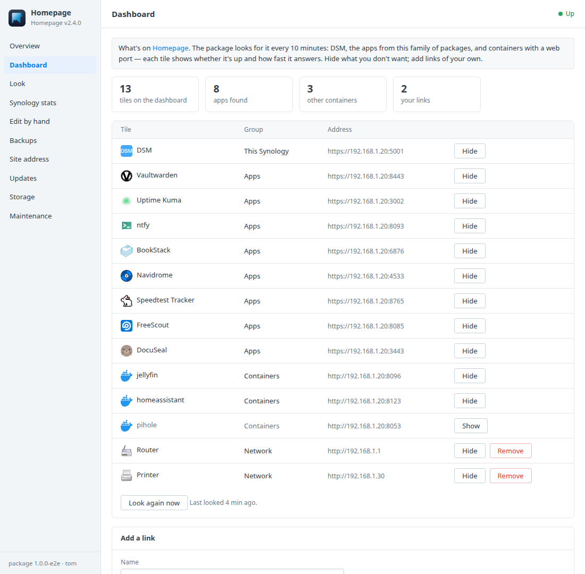
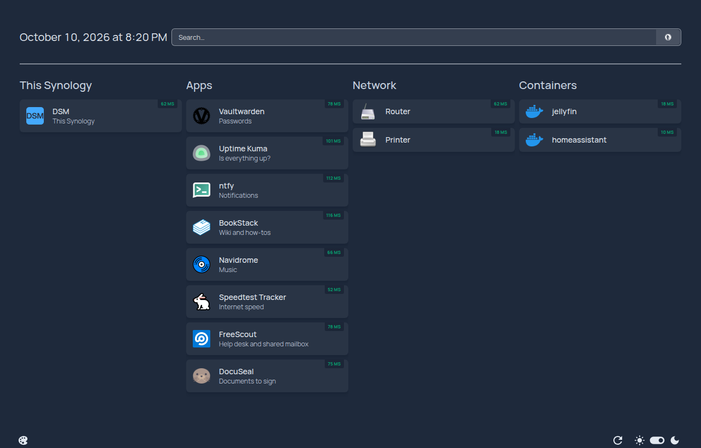
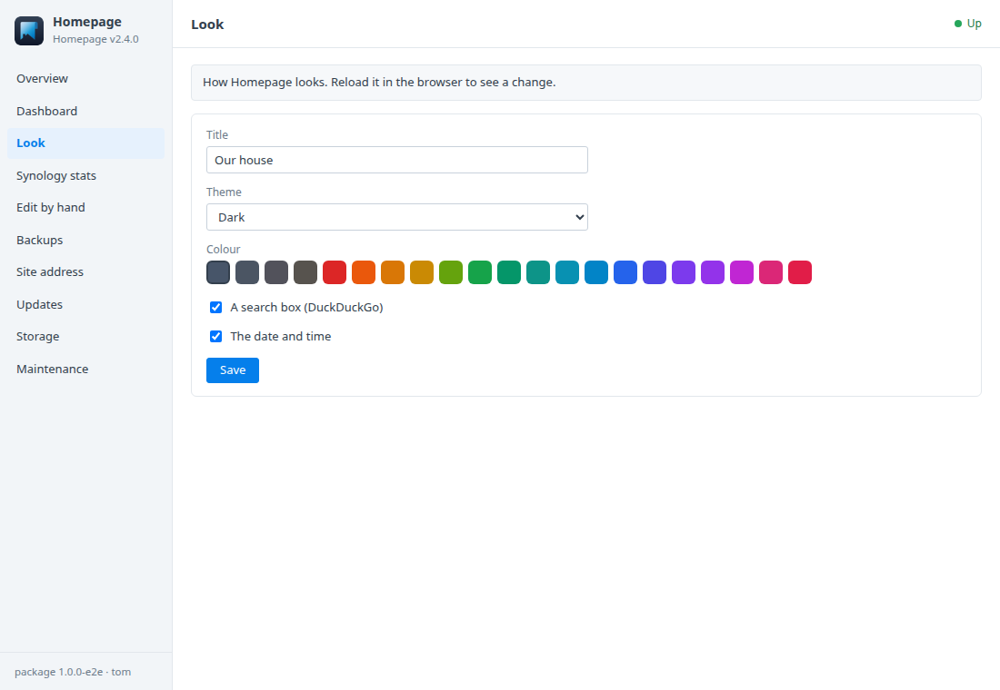
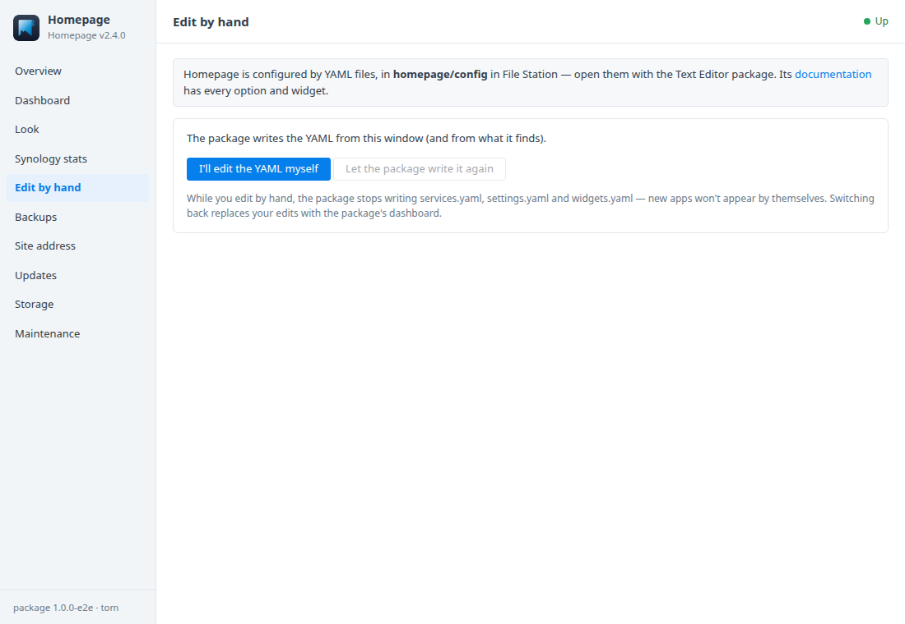

# Homepage for Synology DSM

A DSM 7 package that installs [Homepage](https://gethomepage.dev) — a fast,
good-looking start page for your home network — in Container Manager, and
**fills it in for you**: DSM with its live stats, every app from this family
of packages, and your other containers, each tile showing whether it's up and
how fast it answers. A **Homepage** window in DSM adds links of your own, the
look, and a switch to take over the YAML yourself. Built on the
[DSM app chassis](https://github.com/tombruton87/dsm-app-chassis).

## Download

### **[⬇ Download homepage.spk](https://github.com/tombruton87/homepage-dsm/releases/latest/download/homepage.spk)**

[](https://github.com/tombruton87/homepage-dsm/releases/latest)

That link always gives the newest version. Older ones are on the
[Releases](https://github.com/tombruton87/homepage-dsm/releases) page.

Install: Package Center → Manual Install → the `.spk` (DSM 7.2.1+; Container
Manager is installed first if missing). The wizard asks for the NAS's address,
a port (3010 by default), a time zone and the dashboard's title.

## What the DSM window adds

- **Dashboard** — what the package found, looked for again every 10 minutes:
  - DSM itself;
  - the apps from this family (FreeScout, Vaultwarden, Uptime Kuma, DocuSeal,
    ntfy, BookStack, Navidrome, Speedtest Tracker) with their own icons;
  - any other container with a web page on a published port. Databases and
    other non-web ports are left out.

  Hide what you don't want, and add links of your own (router, printer…) in
  groups of your own. Uptime Kuma's tile shows its status-page numbers when it
  has a published one.
- **Look** — title, dark or light, one of Homepage's colours, a search box,
  the date and time.
- **Synology stats** — CPU, memory, uptime and free space on the DSM tile,
  from a DSM user you make for it. Test it before saving. The password is kept
  root-only and handed to Homepage in its environment, never written into the
  YAML.
- **Edit by hand** — the configuration is plain YAML in the *homepage* shared
  folder (open it with the Text Editor package). One switch makes the package
  leave it alone, and another hands it back.
- **Site address** — Homepage only answers for host names it was told about.
  The package tells it the address you set, and the NAS's own, every time
  either changes.
- **Backups, updates, storage, maintenance** — the dashboard and the config
  folder in one file, made nightly or on demand, with restore. You can also:
  - update to newer images or a newer package from inside DSM;
  - make a redacted support report;
  - read the logs;
  - remove Homepage and everything with it.

## Screenshots

| | |
|---|---|
|  |  |
|  |  |

## How it works

Homepage (`ghcr.io/gethomepage/homepage`) runs as one container. Its `config`
and `images` folders are in the *homepage* shared folder.

The package finds apps with `docker ps`:
- only ports published on every address count, not ones bound to localhost;
- a port is listed only if it answers as a web page;
- each one is probed for https first, then http.

From what it finds and your choices, it writes `services.yaml`,
`settings.yaml` and `widgets.yaml`. Each tile gets a `siteMonitor`. Homepage
caches its page, so the package asks it to rebuild after every change.

## Layout

```
chassis/          the DSM app chassis (git submodule)
package.conf      name, title, services, images, port, texts
app/compose.yaml  Homepage
setup/app.sh      the hooks: discovery, the YAML, DSM stats, allowed hosts, backups
ui/               Dashboard, Look, Synology stats and Edit by hand tabs; CGI validation (free text travels base64url)
wizard/           the Homepage page of the install wizard
tests/            steps for the chassis harness, with stand-in app containers
```

Test: `chassis/tests/e2e.sh . up && chassis/tests/e2e.sh . act` on any Linux
box with Docker.

Release: bump `VERSION`, add the changes to `CHANGELOG.md`, build, then attach
the package twice, under its versioned name and as `homepage.spk`:

```bash
cp dist/homepage-X.Y.Z-1.spk /tmp/homepage.spk
gh release create vX.Y.Z dist/homepage-X.Y.Z-1.spk /tmp/homepage.spk
```

Build: `chassis/build.sh . N`.

## Credits

The icon is Homepage's own mark on a DSM-style tile in slate. Icons on the
dashboard come from [dashboard-icons](https://github.com/homarr-labs/dashboard-icons).
Homepage is GPL-3.0 software by its contributors (gethomepage). This package is
not affiliated with Homepage or Synology.
